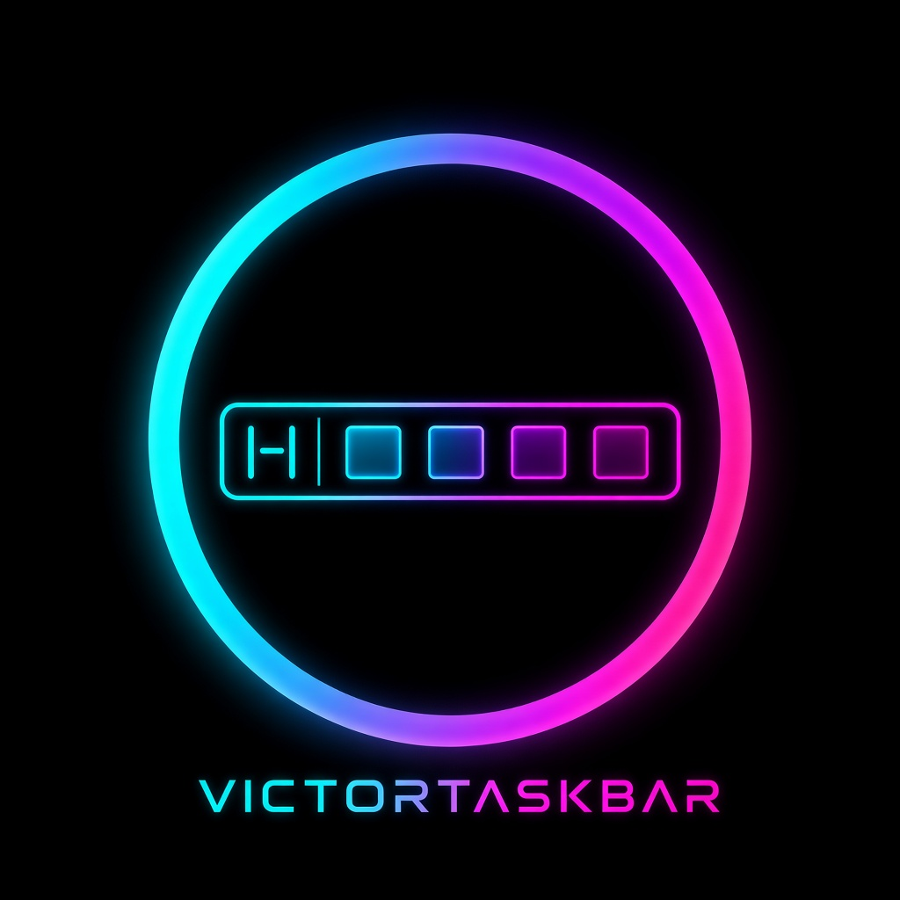

<p align="center">
  
</p>

# VictorTaskbar

A desktop-style taskbar for Android: a bar along the bottom of the screen, drawn over other apps,
with a start menu, pinned apps, recent apps, a clock and a battery indicator.

Status: MVP scaffold (v0.1.0). See [ROADMAP.md](ROADMAP.md) and [MANUAL.md](MANUAL.md).

## Tech
- Kotlin + Jetpack Compose, package `com.victorious.taskbar`
- minSdk 24, compileSdk/targetSdk 36
- Gradle Kotlin DSL with version catalog (`gradle/libs.versions.toml`), Gradle wrapper 8.14.3, AGP 8.13
- ABIs: `arm64-v8a`, `armeabi-v7a`; APK signing v2 + v3

## Build
Requires JDK 17+ and the Android SDK (platform 36).
```
./gradlew assembleDebug
# APK: app/build/outputs/apk/debug/app-debug.apk
```
CI (`.github/workflows/android.yml`) builds the debug APK on every push/PR and uploads it as an artifact.

### Signing
Debug builds are signed with the committed `app/debug.keystore`
(store/key password `android`, alias `androiddebugkey`) so every build, local or CI, has the same
signature and installs over the previous one. **This is a debug key only.** No release keys are in this repo.

## Permissions and consent
| Permission | Why | How it's granted |
|---|---|---|
| `SYSTEM_ALERT_WINDOW` | Draw the taskbar over other apps | Only after the in-app consent screen explains it; the button opens Android's overlay settings |
| `PACKAGE_USAGE_STATS` | Show recently used apps (optional) | Separate consent screen; the button opens Usage access settings. Data stays on device |
| `FOREGROUND_SERVICE` (+ `SPECIAL_USE`) | Keep the taskbar alive | Automatic; shows an ongoing notification |
| `POST_NOTIFICATIONS` | Show that ongoing notification on Android 13+ | Runtime prompt on Start |
| `QUERY_ALL_PACKAGES` | List launchable apps in the start menu | Install-time |

No accessibility service is used.

## Victorious fleet

- Monorepo: [https://github.com/Victorious93/victorious-fleet](https://github.com/Victorious93/victorious-fleet) *(not yet a submodule)*
- Status: [fleet-manifest ROADMAP](https://github.com/Victorious93/fleet-manifest/blob/main/ROADMAP.md)
- Fleet site: [https://victorious-framework.pages.dev](https://victorious-framework.pages.dev)

## License
All rights reserved, Don Victor. See [LICENSE](LICENSE).

## Fleet theme (VictorLaunch)

VictorTaskbar is a **read-only** client of VictorLaunch's fleet theme (spec: victorlaunch `docs/specs/FLEET_THEME.md`).

- On start it queries `content://com.victorious.launch.theme/current`, registers a `ContentObserver`, and listens for the explicit broadcast `com.victorious.launch.action.FLEET_THEME_CHANGED` (exported receiver; extras are ignored, it only triggers a re-query).
- Before querying it verifies that the authority resolves to package `com.victorious.launch` **and** that the signer SHA-256 matches the pinned VictorLaunch cert (not just a signature permission).
- `schemaVersion != 1`, a `SecurityException`, a failed pin, or bad data → built-in neon theme. The app never writes to the provider.
- `palette.*` applies live to both the app and the overlay taskbar.
- **Action for Don:** VictorLaunch must trust VictorTaskbar (add it to `FleetPins.KNOWN`) before the query will succeed; until then the app shows "built-in". VictorTaskbar debug cert SHA-256: `4F:58:A5:C5:75:93:5E:10:3B:1F:73:C0:7A:D2:E0:0A:FF:64:57:76:27:71:1B:77:96:79:37:D5:FC:3B:C2:92`.
