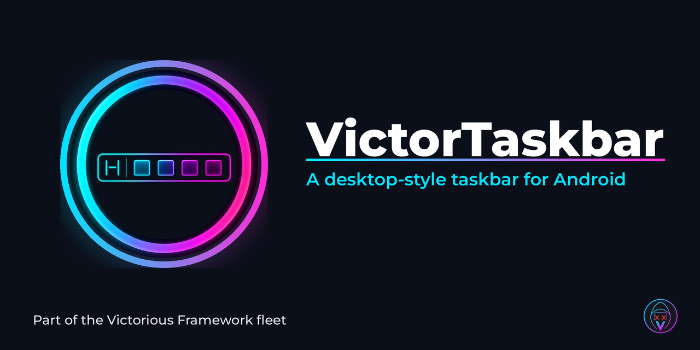

<div align="center">



# VictorTaskbar

**A desktop-style taskbar for Android**

Works on its own; fleet integration (droidcommand-AI) is optional

<p>
  <a href="https://github.com/Victorious93/victortaskbar/releases/tag/v0.1.0-debug"></a>
  <a href="LICENSE"></a>
  <a href="https://github.com/Victorious93/victortaskbar/actions/workflows/android.yml"></a>
  <a href="https://victorious-framework.pages.dev"></a>
</p>

</div>

## Features

- Overlay taskbar along the bottom of the screen, drawn over other apps by a foreground service
- Start menu with app search; pin and unpin apps (stored in DataStore)
- Recent apps via UsageStatsManager (optional usage-access permission)
- Tray: clock and battery indicator
- Consent screens for overlay and usage access before those permissions are requested
- Read-only FleetThemeClient for VictorLaunch's shared theme, with a built-in neon fallback
- Kotlin + Jetpack Compose, package `com.victorious.taskbar` (minSdk 24, compileSdk/targetSdk 36)

Status: MVP scaffold (v0.1.0). Planned work is in [ROADMAP.md](ROADMAP.md) and is not in this build: freeform and split-screen windowing, quick toggles, notification icons, optional Shizuku, and an accessibility service only if it is strictly needed. No accessibility service is used in this build.

## Screenshots

No screenshots of the running app are in the repo yet.

## Install / download

This is a **debug pre-release**, not finished software. Install only if you understand the risk.

There is no stable GitHub Release yet. GitHub's `/releases/latest` link does not resolve, because the only published release is marked as a pre-release.

- Pre-release: [v0.1.0-debug](https://github.com/Victorious93/victortaskbar/releases/tag/v0.1.0-debug)
- APK: [app-debug.apk](https://github.com/Victorious93/victortaskbar/releases/download/v0.1.0-debug/app-debug.apk) from tag `v0.1.0-debug` (`arm64-v8a` and `armeabi-v7a`, about 11.8 MB)

## Build from source

Requires JDK 17+ and the Android SDK (platform 36). Gradle wrapper 8.14.3, AGP 8.13.2.

```
./gradlew assembleDebug
# APK: app/build/outputs/apk/debug/app-debug.apk
```

CI (`.github/workflows/android.yml`) builds the debug APK on every push and pull request and uploads it as the `victortaskbar-debug-apk` artifact.

Debug builds use this repo's fixed debug keystore (`app/debug.keystore`) so every local or CI debug build has the same signature and can install over the previous one. This is a debug key only. Release keys are never committed.

## Manual

How-to: [MANUAL.md](MANUAL.md)

## License

All rights reserved, Don Victor. See [LICENSE](LICENSE).

## Victorious fleet

- Fleet site: [https://victorious-framework.pages.dev](https://victorious-framework.pages.dev)
- Monorepo: [https://github.com/Victorious93/victorious-fleet](https://github.com/Victorious93/victorious-fleet) *(not yet a submodule)*
- Status: [fleet-manifest ROADMAP](https://github.com/Victorious93/fleet-manifest/blob/main/ROADMAP.md)

Official logo files (unchanged): [assets/logo/victortaskbar-logo.png](assets/logo/victortaskbar-logo.png) and the ring-only icon at [assets/logo/victortaskbar-icon-ring.png](assets/logo/victortaskbar-icon-ring.png).

### Fleet theme (VictorLaunch)

VictorTaskbar is a **read-only** client of VictorLaunch's fleet theme (spec: victorlaunch `docs/specs/FLEET_THEME.md`). On start it queries `content://com.victorious.launch.theme/current`, observes changes, and applies `palette.*` live to the app and the overlay. It never writes to the provider. If the provider is missing, the signer pin fails, `schemaVersion` is not 1, or the data is bad, it falls back to the built-in neon theme. Until VictorLaunch lists VictorTaskbar in `FleetPins.KNOWN`, the app stays on the built-in theme. Details and the debug certificate fingerprint are in [MANUAL.md](MANUAL.md).
